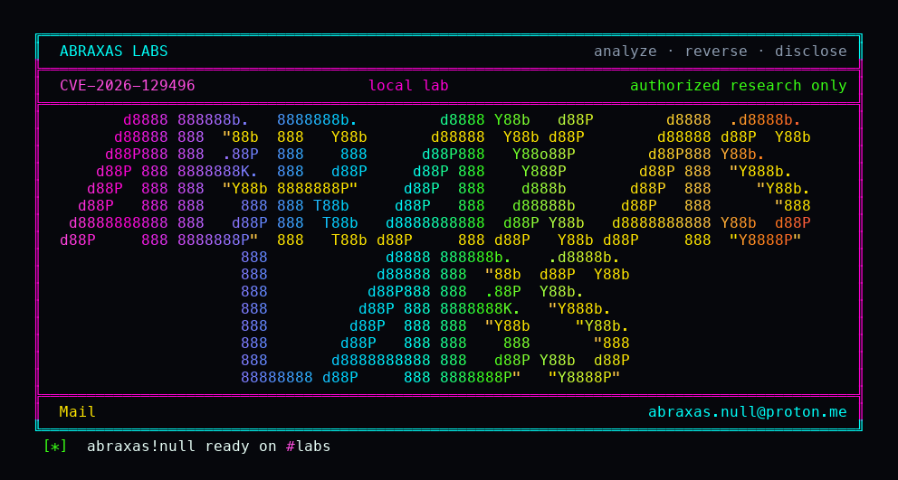

<p align="center">
  
</p>

# php-tzcache-rce

Someone on the internet can talk to a PHP site with no password. If that server wrote a startup warning into a file log, the first request a fresh worker handles can run a command as the account that serves the site. This lab does that on PHP 8.4.27. The same request on 8.4.28 does not. The proof reads the worker's memory map from inside the lab. That is the "known addresses" condition the PHP Group already named. It is not a one-packet attack against a server whose addresses you have never seen.

**Class:** RCE
**Reach:** Remote

**PHP** 8.4.27 (`php:8.4.27-apache`) vs patched 8.4.28 - [GHSA-gr4f-wgx5-jpfv](https://github.com/php/php-src/security/advisories/GHSA-gr4f-wgx5-jpfv)

A file error log during module startup allocates the date extension's timezone cache on a heap that startup then frees. The pointer stays. The date extension clears it only after the next request has already started parsing input. A POST bigger than `memory_limit` dies in that window, and cleanup calls a destructor planted in the freed cache. I pinned Apache prefork to one worker, set `date.timezone=Not/AZone`, and logged to `/var/log/php-error.log`. 8.4.27 writes `CVE-2026-129496-RCE` and the connection resets. 8.4.28 returns HTTP 500 and leaves the file absent.

| | |
|---|---|
| ID | [CVE-2026-129496](https://www.cve.org/CVERecord?id=CVE-2026-129496) |
| Advisory | [GHSA-gr4f-wgx5-jpfv](https://github.com/php/php-src/security/advisories/GHSA-gr4f-wgx5-jpfv) |
| Class | **RCE** |
| Reach | **Remote** (unauthenticated HTTP, fresh worker) |
| CWE | [CWE-416](https://cwe.mitre.org/data/definitions/416.html) / [CWE-459](https://cwe.mitre.org/data/definitions/459.html) |
| CVSS | **Critical: 9.2** `CVSS:4.0/AV:N/AC:H/AT:P/PR:N/UI:N/VC:H/VI:H/VA:H/SC:N/SI:N/SA:N` (PHP Group) |
| Product | [PHP](https://github.com/php/php-src) |
| Affected | PHP 8.2 before 8.2.36, 8.3 before 8.3.37, 8.4 before 8.4.28, 8.5 before 8.5.13 (lab pin **8.4.27**) |
| Fixed | 8.2.36 / 8.3.37 / 8.4.28 / 8.5.13 (19 Nov 2026) |
| Auth | none |
| License | [GNU Affero GPL v3.0](LICENSE) |
| Lab | `127.0.0.1` only |

Thread-safe builds do not take this path. FPM's own error log does not either. The diagnostic has to go through PHP's file `error_log`.

## What an attacker can do

| Method | Sink | Privilege |
|---|---|---|
| Unauthenticated `POST /index.php` with a Basic token and a body over `memory_limit`, on a fresh prefork child | stale `date_globals.tzcache` freed at module startup, destructor called from request cleanup | **Integrity (lab-proven):** worker runs `printf` and writes `CVE-2026-129496-RCE` as `www-data` on 8.4.27. **Availability (lab-proven):** that connection resets. Addresses come from the lab process maps. |
| Same request on 8.4.28 | log timestamps no longer use the request timezone cache outside a live request | **Closed (lab-proven):** HTTP 500, witness file absent, worker stays up. |
| `max_input_vars` warning on the first request | same stale cache, early in input parsing | **Availability (advisory):** crash without the destructor chain. This lab used the memory-limit cleanup path. |
| Thread-safe build, or `error_log` set to syslog | startup log does not allocate the cache this way | **Closed.** Not this bug. |
| Blind remote host, no memory map | ASLR | **Not shown.** The PHP Group said a remote ASLR bypass is plausible and that a complete independent bypass was not demonstrated. This lab does not add one. |
| Login, reverse shell, custom `.so` | n/a | Closed. The witness command is `printf` into `/tmp/w`. |

**Lab-proven vs inferred:** command execution and the patched miss are lab-proven on official `php:8.4.27-apache` vs `php:8.4.28-apache`, aarch64, with addresses read from that container. A crash from `max_input_vars` alone, and code execution without a local map, are not what this run showed.

**Requires:** non-thread-safe Apache `apache2handler`, file `error_log`, a startup diagnostic (`date.timezone=Not/AZone`), `memory_limit=2M`, `LimitRequestFieldSize` large enough for the Basic token, one prefork worker, and `SYS_PTRACE` so the lab can read `/proc/<pid>/mem`. Loopback only.

## Lab

```bash
python3 php-tzcache-rce-Abraxas-Labs.py
```

or `cd lab && ./run.sh`. Loopback `127.0.0.1:18224` (8.4.27) vs `127.0.0.1:18225` (8.4.28). Compose project `cve-2026-129496`. Witness `CVE-2026-129496-RCE`. Last line:

```
SUCCESS CVE-2026-129496 rce=yes
```

Authorized lab only. It talks to loopback.

## The fix

Update to PHP 8.4.28, or 8.2.36 / 8.3.37 / 8.5.13. The fix formats those log timestamps in UTC outside a fully initialized request. Until then, correct the setting that prints at startup, send PHP errors to syslog instead of a file, and restart the master and every worker.

## References

- [GHSA-gr4f-wgx5-jpfv](https://github.com/php/php-src/security/advisories/GHSA-gr4f-wgx5-jpfv)
- [CVE-2026-129496](https://www.cve.org/CVERecord?id=CVE-2026-129496)
- [php/php-src](https://github.com/php/php-src) tag [php-8.4.27](https://github.com/php/php-src/releases/tag/php-8.4.27) vs [php-8.4.28](https://github.com/php/php-src/releases/tag/php-8.4.28)
- [CWE-416](https://cwe.mitre.org/data/definitions/416.html)
- [CWE-459](https://cwe.mitre.org/data/definitions/459.html)

Abraxas Labs
abraxas.null@proton.me
